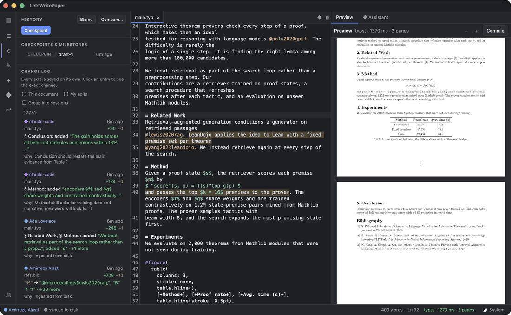
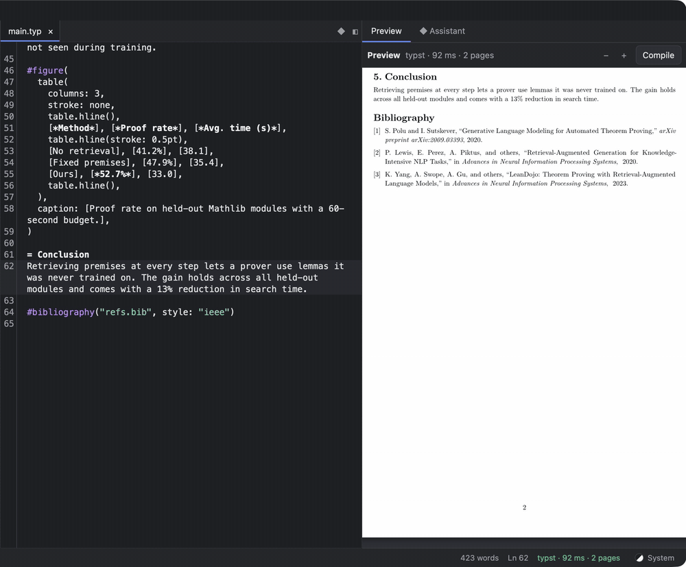
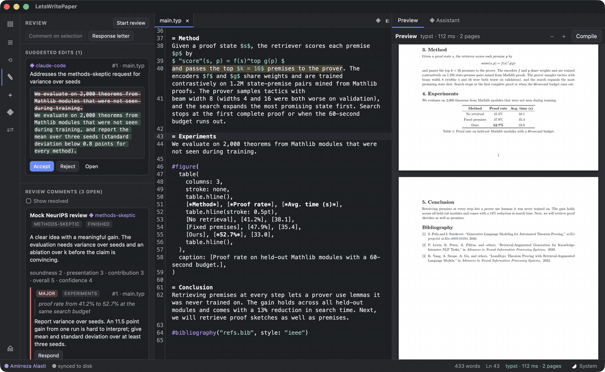
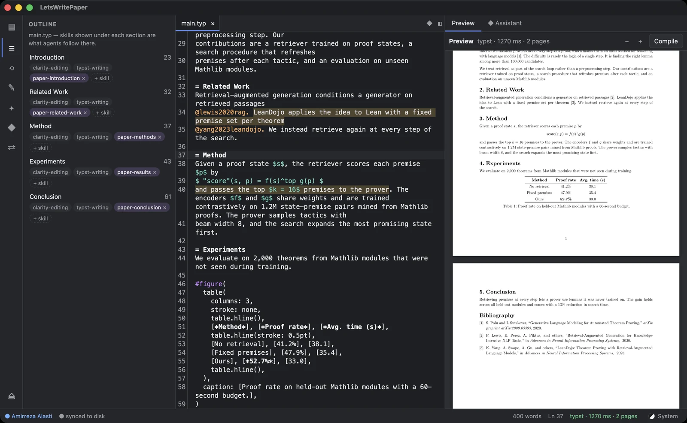
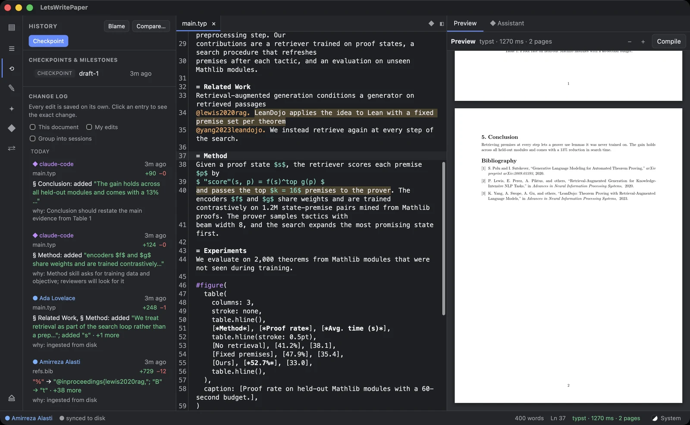
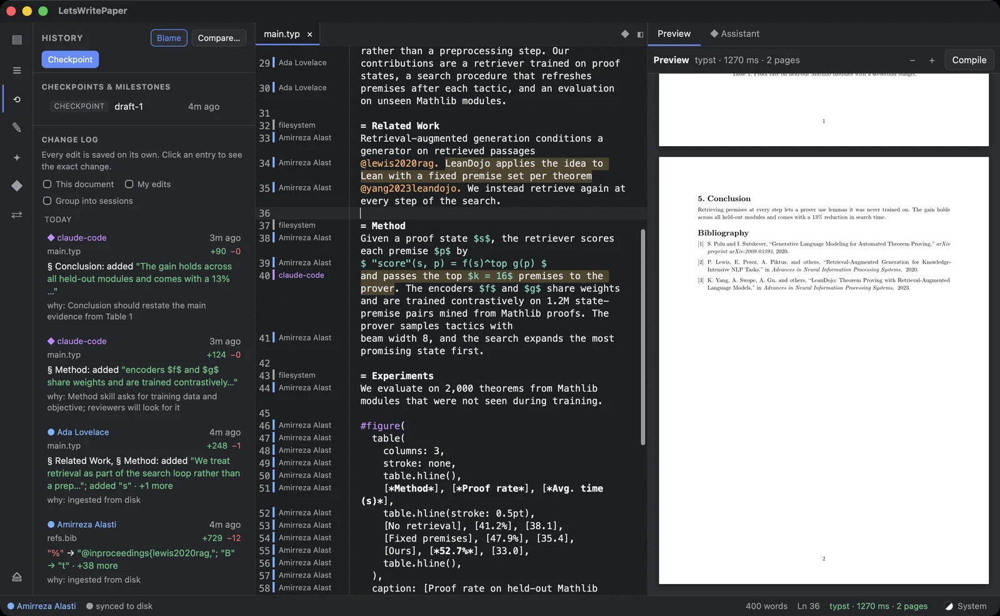
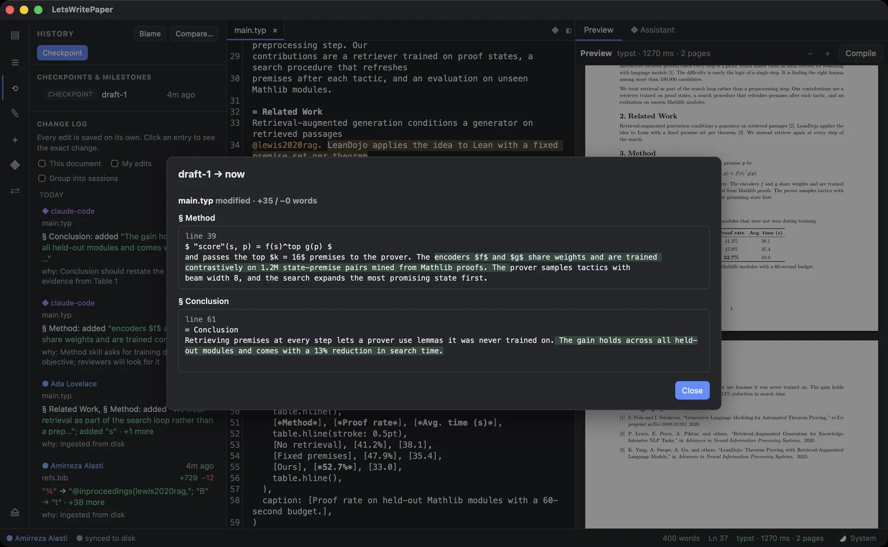
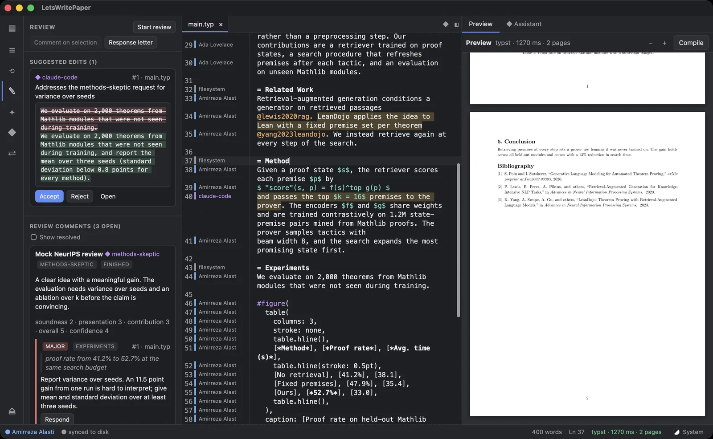
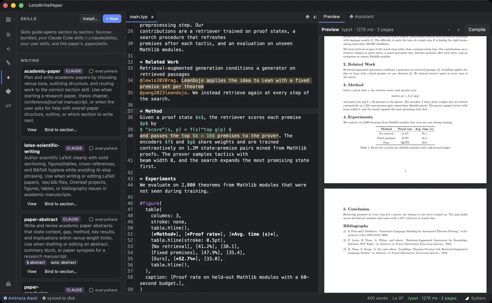

# LetsWritePaper

An editor for academic papers built around version control and AI co-authors. Humans and
agents (Claude Code, Claude in VS Code/Cursor, any MCP client) edit the same LaTeX or Typst
paper live. Every change is recorded with **who** made it, **when** and **why**, and can be
diffed by section, blamed line by line, checkpointed, restored, reviewed and synced to your
other devices.

- **Live co-editing.** Every document is a CRDT (Yjs-compatible, via `yrs`). The editor, agents,
  other tools writing files, and other devices all merge without conflicts.
- **Version control made for papers.** Every edit is its own entry in the change log:
  who made it, when, and a short description of what changed. History can also be
  grouped into edit sessions per author. Diffs are word-level and grouped by section.
  Blame works per character. Named checkpoints and milestones (`submitted`, `rebuttal`,
  `camera-ready`, `arxiv`) also become git commits crediting every human and agent contributor.
- **AI agents as first-class co-authors.** A built-in MCP server offers 23 paper-aware tools:
  section context, exact-excerpt edits, suggested edits, compile, review and more. Agent
  edits show up live, attributed to the agent.
- **The assistant panel.** The app has its own chat panel, like the VS Code/Cursor extension.
  It runs Claude Code, ChatGPT through Codex, or Gemini through Antigravity, each with your
  own account. Chats know your file, section and selection. Claude chats can also continue
  on another device through Claude Code's Remote Control.
- **Skills.** A skill is a `SKILL.md` file of writing or review instructions, bound to sections
  (e.g. `intro*` → `paper-introduction`). 13 skills ship built in, your existing
  `~/.claude/skills` are picked up automatically, and you can add per-paper skills.
- **Peer review.** Review rounds can come from humans or reviewer personas (methods-skeptic,
  clarity, novelty, reproducibility, area chair). Comments carry severity and category and are
  anchored to quotes that follow the text as it changes. Rounds record rubric scores, take
  author responses, and export a Markdown response-to-reviewers letter.
- **Cross-device sync.** Share a paper from the app on your local network, or through a relay
  server (`paper serve`). Other devices join from a link and keep full, offline-capable
  copies.
- **Live preview.** Typst compiles in-process from the live text, typically in milliseconds.
  LaTeX compiles with `tectonic` (recommended) or `latexmk`, and diagnostics are clickable.
- **Cross-platform.** Written in Rust with a Tauri 2 desktop app for macOS, Windows and Linux,
  plus a `paper` CLI.

## See it work

Recorded in the desktop app on a sample Typst paper. The agent edits go through the same MCP tools Claude Code uses.

**An agent edits the paper live.** Claude Code changes the Method section through MCP. The editor, the change log (with the agent's reason) and the preview update as it happens.



**Typst preview while you type.**



**Accepting an agent's suggested edit** from the review panel, next to the reviewer comments it answers.



| | |
|---|---|
|  Editor, section skills and preview |  Change log: who, what and why |
|  Blame, per line, for people and agents |  Word-level diff by section |
|  Review comments and suggested edits |  Writing and review skills |

## Website

The public site lives in [`web/`](web/) and is deployed at [letswritepaper.vercel.app](https://letswritepaper.vercel.app). It introduces the app and links to the desktop installers on the latest GitHub release. The Vercel project root is `web`.

```sh
cd web
pnpm install
pnpm dev
```

The download buttons point at `LetsWritePaper-macos.dmg`, `LetsWritePaper-x64-setup.exe`, and `LetsWritePaper-x64.AppImage` on the latest GitHub release of `GITHUB_REPOSITORY` (default `amirrezaalasti/LetsWritePaper`). A clone of the repository is only for building the app yourself.

## Install

Download the app. Rust, Node, and a clone of this repository are only needed to build it from source.

A version tag such as `v0.1.0` publishes these files. Until that first release exists, the links have nothing to download.

### macOS

[LetsWritePaper-macos.dmg](https://github.com/amirrezaalasti/LetsWritePaper/releases/latest/download/LetsWritePaper-macos.dmg)

Or:

```sh
curl -fsSL https://raw.githubusercontent.com/amirrezaalasti/LetsWritePaper/main/install.sh | bash
```

The command downloads the latest release and copies LetsWritePaper into your Applications folder.

### Windows

[LetsWritePaper-x64-setup.exe](https://github.com/amirrezaalasti/LetsWritePaper/releases/latest/download/LetsWritePaper-x64-setup.exe)

Run that setup wizard. It installs for the current user, adds a Start menu folder, and downloads the WebView2 runtime when Windows needs it.

```powershell
irm https://raw.githubusercontent.com/amirrezaalasti/LetsWritePaper/main/install.ps1 | iex
```

### Linux

[LetsWritePaper-x64.AppImage](https://github.com/amirrezaalasti/LetsWritePaper/releases/latest/download/LetsWritePaper-x64.AppImage)

Or:

```sh
curl -fsSL https://raw.githubusercontent.com/amirrezaalasti/LetsWritePaper/main/install.sh | bash
```

The command installs the AppImage for your user and adds an application menu entry. When a `.deb` or `.rpm` is also on the release and you run the script in a terminal, you can choose the system package instead.

The first time the app opens, a setup wizard asks for the name your edits should be attributed to. It can install [tectonic](https://tectonic-typesetting.github.io/) for LaTeX preview, and Claude Code, Codex, or Antigravity for the assistant panel. Typst preview is already in the app. **Set up this computer…** on the start screen opens that wizard again.

## Building from source

### Requirements

- Rust 1.95+ (`rustup`), Node 20+ and `pnpm`. Typst 0.15 needs 1.92, and `yrs` 0.28 uses `if let` guards from 1.95.
- For LaTeX preview: [`tectonic`](https://tectonic-typesetting.github.io/) (the setup wizard installs it) or a TeX
  distribution with `latexmk`. Typst preview is built into the desktop app.
- On Linux, the Tauri system packages: `libwebkit2gtk-4.1-dev libayatana-appindicator3-dev librsvg2-dev patchelf`.
- For the assistant panel: Claude Code, Codex, or Antigravity (the setup wizard can install hem) and thet matching account. Claude can use a Claude account or an API key. ChatGPT uses a ChatGPT login or an OpenAI API key. Gemini uses a Google AI Pro or Ultra account through Antigravity, or a Gemini API key.

### Desktop app

```sh
cd app
pnpm install
pnpm tauri dev          # development
pnpm tauri build        # dmg, Windows setup wizard, deb, rpm, AppImage
```

People installing the app use the downloads above. `bash install.sh` from this repository installs a build in `app/src-tauri/target` when one is there, and otherwise downloads the latest release.

### Signed releases

macOS Gatekeeper and Windows SmartScreen warn on unsigned downloads. Nothing inside the app removes those checks. A tagged release signs the installers when the GitHub Actions secrets below are set, and otherwise still publishes an unsigned build.

**macOS.** An Apple Developer Program membership and a Developer ID Application certificate. Notarization uses either an App Store Connect API key or an Apple ID app-specific password.

| Secret | Value |
|---|---|
| `APPLE_CERTIFICATE` | Base64 of the exported `.p12` (`openssl base64 -A -in certificate.p12`) |
| `APPLE_CERTIFICATE_PASSWORD` | Password for that `.p12` |
| `APPLE_SIGNING_IDENTITY` | Optional. For example `Developer ID Application: Name (TEAMID)` |
| `APPLE_API_KEY` | App Store Connect Key ID |
| `APPLE_API_ISSUER` | App Store Connect issuer ID |
| `APPLE_API_KEY_P8` | Contents of the downloaded `AuthKey_….p8` file |
| `APPLE_ID` | Apple ID email, used when the API key secrets are unset |
| `APPLE_PASSWORD` | App-specific password |
| `APPLE_TEAM_ID` | Team ID from the membership page |

The API key is used when `APPLE_API_KEY`, `APPLE_API_ISSUER`, and `APPLE_API_KEY_P8` are all set. Otherwise the Apple ID, password, and team ID are required. A certificate without notarization credentials fails the macOS release, because a signed app that was not notarized still fails Gatekeeper.

**Windows.** Azure Artifact Signing, or a `.pfx` code-signing certificate. Azure is the practical choice for a new certificate: since 2023 most new certificates cannot be exported as a file, and SmartScreen reputation is tied to the signing identity. A brand-new identity can still show SmartScreen until that publisher has been downloaded enough. Signing every release with the same identity is what carries the reputation forward.

| Secret | Value |
|---|---|
| `AZURE_CLIENT_ID` | App registration client ID |
| `AZURE_CLIENT_SECRET` | App registration client secret |
| `AZURE_TENANT_ID` | Directory tenant ID |
| `AZURE_SIGNING_ENDPOINT` | For example `https://wus2.codesigning.azure.net` |
| `AZURE_SIGNING_ACCOUNT` | Artifact Signing account name |
| `AZURE_SIGNING_CERTIFICATE_PROFILE` | Certificate profile name |
| `WINDOWS_CERTIFICATE` | Base64 of a `.pfx`, used when the Azure secrets are unset |
| `WINDOWS_CERTIFICATE_PASSWORD` | Password for that `.pfx` |

### CLI

```sh
cargo install --path crates/paper-cli      # installs `paper`
paper init --title "My Paper" --format typst   # or: latex (imports existing .tex/.bib)
paper watch                                    # mirror files, record outside edits, sync
```

## Working with agents

`paper init` (and *New paper* in the app) configures the project for Claude Code:

- `.mcp.json` registers the `paper` MCP server.
- `.claude/settings.json` adds a hook that credits Claude's direct file edits to `claude-code`
  instead of "external".
- `AGENTS.md` / `CLAUDE.md` explain the workflow to agents.

Open the paper folder in VS Code or Cursor with the Claude extension, or run `claude` there,
and ask for what you need ("tighten the related work", "run a mock NeurIPS review"). For other
MCP clients, run `paper mcp` (or `letswritepaper mcp`) in the project folder. Agents identify
themselves through MCP; override with `--agent <name>`.

Prompts are exposed as slash commands (`/mcp__paper__write-section`, `/mcp__paper__review-paper`,
`/mcp__paper__address-reviews`, and one `skill:<name>` per skill).

<details>
<summary>MCP tools</summary>

`project_overview`, `read_document`, `outline`, `search`, `section_context`, `edit_document`,
`write_document`, `propose_edit`, `list_proposals`, `history`, `diff`, `blame`, `checkpoint`,
`compile`, `list_skills`, `get_skill`, `bind_skill`, `create_skill`, `start_review`,
`add_review_comment`, `finish_review`, `list_review_comments`, `respond_to_comment`.
</details>

### The assistant panel

Click **◆ Assistant** (⌘/Ctrl+L) in the app. 🔑 asks which assistant to use — Claude, ChatGPT,
or Gemini — then the account and model. If that assistant's program is missing, **Install**
runs its official installer. Sign-in opens a terminal: Claude Code for Claude, `codex login`
for a ChatGPT account, and `agy` for a Google AI Pro or Ultra account. An API key, when you
choose one, is handed to that program and is not saved in the paper.

Claude chats run your own Claude Code (`claude -p --input-format stream-json …`). ChatGPT
chats run Codex (`codex exec --json`). Gemini chats run Antigravity
(`agy --input-format stream-json`). Each one is connected to this paper's MCP server, and
each keeps its own chats. You can switch among them from 🔑.

- **Model.** The model menu lists the models that provider serves. The same alias is a
  different model on each one: Sonnet is Sonnet 5.5 on Anthropic, Sonnet 4.5 on Bedrock and
  Agent Platform, and Foundry's Opus alias is Opus 4.6. Changing it restarts the chat.
- **Modes.** *Paper tools* (default) pre-approves the paper tools and reading files. With Claude,
  web search and anything else ask you to allow them in the chat. *Paper tools + file edits*
  also accepts file edits without asking. ChatGPT and Gemini cannot ask in the panel, so
  Gemini pre-approves its tools and ChatGPT's file-editde aung to-approves workspace edits.
- **Context.** Each message carries the open file, cursor section and selection (toggle
  *Editor context*).
- **Files.** Paste, drop, or use 📎 to attach images and files (4 MB each, 8 MB per message).
  Claude sees images and PDFs in the message. ChatGPT receives images with the message.
  Gemini is given the saved file so it can read it. Files are kept in `.paper/attachments`.
- **Slash commands.** In a Claude chat, type `/`. `/usage` and `/status` show this account's
  session, weekly, and extra-usage limits. Screens such as `/plugin` and `/skills` open in
  Claude Code's terminal, because that program only runs them there. `/context` and `/compact`
  run in the chat.
- **Sessions.** Pick an earlier chat from the menu to resume it (`--resume`).
- **📱 Continue on another device.** Hands the chat to Claude Code's
  [Remote Control](https://code.claude.com/docs/en/remote-control.md), so you can keep talking
  to it from claude.ai/code or the Claude mobile app while it keeps editing the paper on this
  computer. This needs a Claude Pro, Max, Team or Enterprise login (API keys are not
  supported) and this computer must stay awake.

## Sharing across devices

In the app, go to **⇄ Share**:

- **Share on this network.** The app hosts a relay. Devices on the same Wi-Fi/LAN join while it
  runs.
- **Share via relay server.** Use a relay reachable from anywhere:

  ```sh
  paper serve --port 8787 --data /var/lib/paper-relay --secret "$(openssl rand -hex 16)"
  # or with Docker:
  docker build -f deploy/relay.Dockerfile -t paper-relay .
  docker run -p 8787:8787 -v paper-relay:/data -e PAPER_RELAY_SECRET=… paper-relay
  ```

  Put it behind HTTPS (Caddy, nginx, or a tunnel such as Cloudflare Tunnel or Tailscale).

  To run that container as a small always-on server, use Fly.io (`fly.toml`).
  A 256 MB machine is about $2.20/month in Ashburn and a little more in Amsterdam,
  plus about $0.15 for 1 GB of disk. HTTPS is included on `https://<app>.fly.dev`.
  Skip a dedicated IPv4 address; that adds $2/month. The Fly trial stops the
  process after 5 minutes and only includes 2 machine-hours, so add a card
  before anyone shares a paper. Sleeping free hosts (Render’s free instance,
  Heroku Eco) drop live edits as soon as the process stops.

  ```sh
  fly auth login
  fly launch --copy-config --no-deploy   # creates the app; change `app` in fly.toml if the name is taken
  fly secrets set PAPER_RELAY_SECRET="$(openssl rand -hex 16)"
  fly deploy
  ```

  A $0 machine that stays up is Google Cloud’s always-free `e2-micro` (one VM,
  30 GB disk, 1 GB outbound per month, in `us-central1`, `us-east1`, or
  `us-west1`). New accounts also get $300 for 90 days. You install Docker and
  put Caddy in front of port 8787 yourself.

On the other device, use **Join a shared paper…** in the app, or run
`paper join '<link>' [dir]` and then `paper watch`. Every copy keeps its full history, works
offline, and merges when it reconnects. The link contains the paper's access token, so
anyone who has it can read and edit the paper. Share it like a password.

## Skills

```sh
paper skill list                              # bundled, ~/.claude/skills, user and project skills
paper skill for "Related Work"                # which skills apply to a section, and why
paper skill bind paper-methods --section "approach*"
paper skill add ./my-venue-style              # folder containing SKILL.md (project) — or --user
paper skill new lab-style --section "intro*"  # scaffold .paper/skills/lab-style/SKILL.md
```

Skill bindings live in `paper.toml`:

```toml
[skills]
global = ["clarity-editing", "latex-hygiene"]

[skills.sections]
"abstract" = ["paper-abstract"]
"related*" = ["my-lab-related-work"]
```

## Version control

```sh
paper log                      # every change: who, when, and what changed
paper log --sessions           # the same edits grouped into sessions per author
paper diff draft-1 now         # word-level, grouped by section
paper blame main.tex
paper checkpoint submitted-v1 -m "NeurIPS submission" --milestone submitted
paper show main.tex --at submitted-v1
paper restore main.tex draft-1 # recorded as a new edit; nothing is lost
paper proposals                # suggested edits: accept / reject
paper review comments --status open
paper review letter > response.md
```

## Repository layout

| Path | What it is |
| --- | --- |
| `crates/paper-core` | Document CRDTs, history store, diff/blame, checkpoints, proposals, reviews, skills, sync records |
| `crates/paper-compile` | In-process Typst; LaTeX via tectonic/latexmk; diagnostics |
| `crates/paper-mcp` | MCP server (JSON-RPC over stdio) |
| `crates/paper-sync` | Relay server and sync client |
| `crates/paper-cli` | The `paper` command |
| `app/` | Tauri 2 desktop app (Rust backend in `src-tauri`, TypeScript + CodeMirror frontend) |
| `web/` | Public site: introduction and downloads, deployed on Vercel |
| `skills/` | Bundled skills (embedded at build time) |

See [docs/ARCHITECTURE.md](docs/ARCHITECTURE.md) for how the pieces fit together.

## Status and known limitations

This is an early (0.1) version.

- No SyncTeX jump between the PDF and the source yet. LaTeX preview re-renders the whole PDF.
- The relay speaks plain HTTP. Use HTTPS in front of it for anything beyond a trusted LAN.
- The assistant panel drives the Claude Code, Codex, or Antigravity CLI installed on your
  machine, with your own account. If you plan to distribute builds to other people, review
  each vendor's terms on offering account login in third-party products; API-key login is
  the safe default.
- Tests run on macOS. Windows and Linux builds are covered by CI configuration but haven't
  been exercised by hand yet.

## Contact

LetsWritePaper is built by Amirreza Alasti. For investment, sponsored features, or development work on or around the app, get in touch:

- Email: [amirrezaalasti@gmail.com](mailto:amirrezaalasti@gmail.com)
- Website: [amirrezaalasti.de](https://www.amirrezaalasti.de/)
- LinkedIn: [Amirreza Alasti](https://www.linkedin.com/in/amirreza-alasti-61450b1aa/)
- GitHub: [@amirrezaalasti](https://github.com/amirrezaalasti)

## Contributing

See [CONTRIBUTING.md](CONTRIBUTING.md). This project follows the [Contributor Covenant](CODE_OF_CONDUCT.md). Report security issues the way [SECURITY.md](SECURITY.md) describes.

## License

Licensed under the [MIT license](LICENSE).

## Development

```sh
cargo test --workspace         # core, compile, MCP, sync (incl. a live relay test)
cargo clippy --workspace --all-targets
cd app && pnpm typecheck
```
